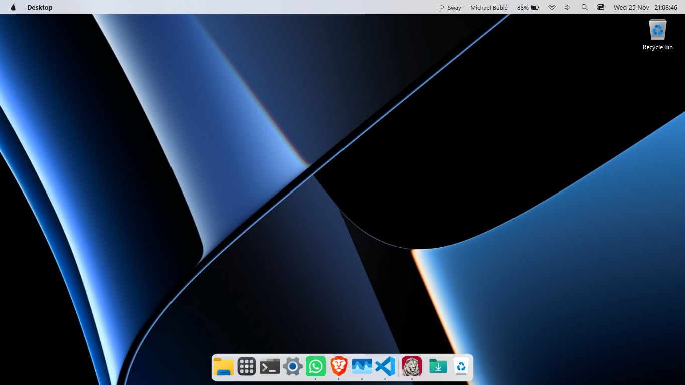
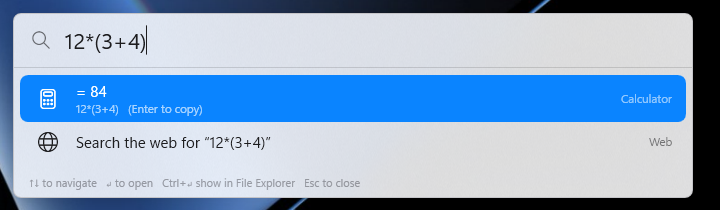
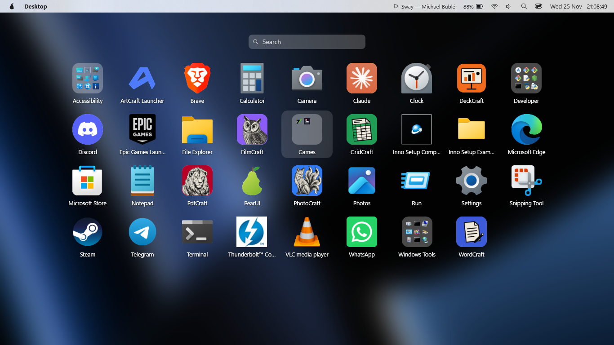
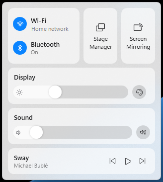
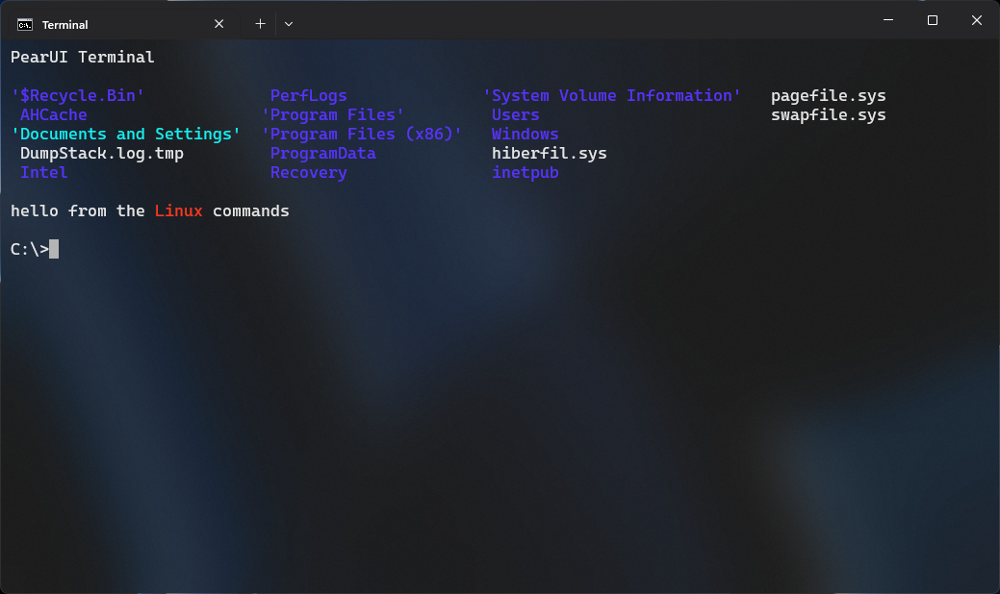
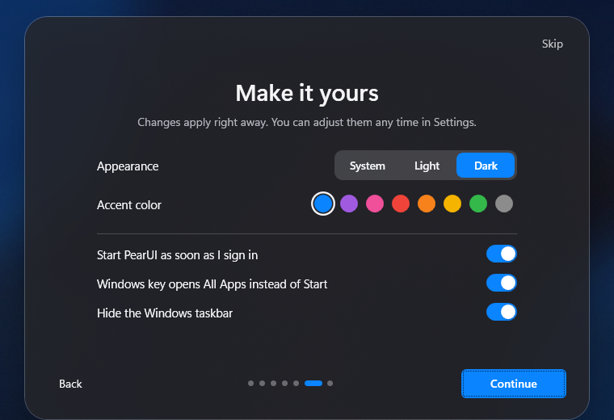

<div align="center">


# PearUI

**A calm, Mac inspired desktop for Windows 10 and 11.**<br>
Menu bar, Dock, instant search, an All Apps screen, Control Center, Stage Manager and a Mac style Terminal, all running quietly on top of your normal Windows.

[**Download the installer**](https://github.com/guruswarupa/PearUI/releases/latest) · [What you get](#what-you-get) · [Install](#install) · [Build it yourself](#build-from-source)

<br>

<picture>
  <source media="(prefers-color-scheme: dark)" srcset="docs/screenshots/desktop-dark.png">
  
</picture>

</div>

> PearUI is an independent project. It is not affiliated with or endorsed by Apple. Mac and macOS are trademarks of Apple Inc.

---

## What you get

PearUI adds a layer on top of Windows. It does not replace File Explorer and never modifies system files. You can turn any part of it off in Settings, and uninstalling puts everything back.

### Menu bar and Dock

A slim menu bar runs across the top of every display: the pear menu (Settings, Sleep, Restart, Shut Down, Lock…), the name of the app you're using with File / Edit / View / Window / Help menus, and on the right your now-playing track, battery, Wi‑Fi, volume, search, Control Center and the clock. Its menus are real frosted glass.

The Dock sits at the bottom with your pinned and running apps. Icons grow as you hover, bounce when an app starts, and a small dot marks the ones that are running. It slides away when you don't need it and comes back when you push the pointer to the bottom edge (or whenever the desktop is empty).

- **Drag files onto it:** drop on the Recycle Bin to recycle them, on Downloads to move them there, or on an app to open them with it.
- **Downloads stack:** click Downloads to see your latest files with previews. Click one to open it, or drag it out.
- Right-click an icon for its windows, Keep in Dock, Show in File Explorer, Hide and Quit.

### Search

Press **`Alt` + `Space`** to find apps, files, settings pages and commands, or just type a sum.

<picture>
  <source media="(prefers-color-scheme: dark)" srcset="docs/screenshots/search-dark.png">
  
</picture>

### All Apps

Tap the **Windows key** (or `Alt` + `F1`, or the Dock icon) for every installed app on one full-screen page, over a soft blur of your wallpaper. Type to search, swipe with two fingers to change page, and pinch to close.



**Folders:** drag one app onto another to make a folder, drop apps onto a folder to add them, and drag them back out to remove them. Rename a folder by opening it and clicking its name. Duplicate shortcuts for the same program are merged, so VLC shows up once.

### Control Center

Click the toggle icon in the menu bar for volume, brightness, dark mode, media controls, Stage Manager and Screen Mirroring.

<picture>
  <source media="(prefers-color-scheme: dark)" srcset="docs/screenshots/control-center-dark.png">
  
</picture>

- **Wi‑Fi and Bluetooth:** left-click turns them on or off. **Right-click** to pick a network (it asks for the password when a new network needs one) or connect to a paired Bluetooth device.
- **Dark Mode** switches the whole desktop, Windows included.

### Stage Manager and Hot Corners

Turn on **Stage Manager** to keep one app in focus. Push the pointer to the left edge of the screen and tilted previews of your other recent apps slide in; click one to bring it forward.

**Hot Corners** run an action when you push the pointer into a corner of the screen: Mission Control (all windows), show the desktop, Notification Center, All Apps, Search, Stage Manager, lock, or turn the display off. Defaults are Mission Control at the bottom-left and the desktop at the bottom-right.

### Terminal and Linux commands

The installer turns Command Prompt into a translucent, Mac-style Terminal and adds the everyday Linux commands to it.



`ls`, `grep`, `cat`, `touch`, `head`, `tail`, `which`, `sed`, `awk`, `nano` and more work right in Command Prompt, with `ll`, `la`, `pwd` and `clear` as aliases. Windows' own commands like `find` and `sort` keep priority, so nothing that relies on them breaks.

### A friendly first start

The first time PearUI opens, a short welcome tour shows what's where and lets you choose light or dark, an accent color, and whether the Windows key opens All Apps. You can bring it back any time from the pear menu → *Welcome to PearUI…*.

<p>
  
  
  
</p>

### Also

- **Real blur and rounded corners** wherever it fits, with a clean see-through fallback if Windows' *Transparency effects* is off.
- **Windows key** can open All Apps instead of Start. Shortcuts like `Win` + `E`, `Win` + `D` and `Win` + `Tab` keep working.
- **Windows taskbar** can be hidden while PearUI runs. It always comes back when PearUI quits, even after a crash.
- **Starts first at sign-in:** a sign-in task launches PearUI right at logon at high priority.

---

## Install

1. Download **`PearUI-Setup-x.y.z.exe`** from the [latest release](https://github.com/guruswarupa/PearUI/releases/latest) and run it. PearUI itself needs no administrator rights and no .NET to be installed.
2. Choose what you want:

| Option | What it does |
|---|---|
| Start PearUI as soon as I sign in | Starts PearUI at logon at high priority. |
| macOS-style Terminal | Installs Windows Terminal if needed, makes Command Prompt the default with the translucent look, and sets Windows Terminal as Windows' default terminal. Your old Terminal settings are saved as `settings.json.pearui-backup`. |
| Linux commands in Command Prompt | Installs Git for Windows if needed and adds its Linux tools to the end of your PATH. |
| Full Linux (WSL) | Optional and off by default. Needs administrator approval and a restart. |

To **uninstall**, use *Settings → Apps*. It brings back the taskbar, your Terminal settings, your PATH and all start-up entries. Your PearUI settings in `%APPDATA%\PearUI` are kept, and Git for Windows and WSL are left installed.

> **Windows warnings.** Windows may warn about an installer that isn't code-signed: choose *More info → Run anyway*. If **Smart App Control** is switched on, it blocks unsigned programs completely. Either turn it off in Windows Security → App & browser control, or use a signed release (see [Publish a release](#publish-a-release)).

---

## Build from source

You need the .NET 8 SDK.

```powershell
powershell -ExecutionPolicy Bypass -File .\install.ps1              # build, install for this user, set everything up, launch
powershell -ExecutionPolicy Bypass -File .\install.ps1 -Uninstall   # remove it again
```

While developing you can also run it straight from the build folder:

```powershell
dotnet build src\MacUI\MacUI.csproj
src\MacUI\bin\Debug\net8.0-windows10.0.22621.0\PearUI.exe           # start (start it again to open Settings)
src\MacUI\bin\Debug\net8.0-windows10.0.22621.0\PearUI.exe --quit    # stop the running copy cleanly
```

## Publish a release

1. Push a version tag:

   ```powershell
   git tag v1.0.0
   git push origin v1.0.0
   ```

2. The **Release** workflow (`.github/workflows/release.yml`) builds `PearUI-Setup-1.0.0.exe` and attaches it to a new GitHub release.

To build the installer on your own PC, install Inno Setup (`winget install JRSoftware.InnoSetup`) and run:

```powershell
powershell -ExecutionPolicy Bypass -File installer\build-installer.ps1 -Version 1.0.0   # → dist\PearUI-Setup-1.0.0.exe
```

The installer is self-contained (no .NET needed on the user's PC) and pre-compiled for a quick start. To **code-sign** releases, sign `dist\publish\PearUI.exe` and the installer with `signtool` (Azure Trusted Signing works well for open-source projects). That removes the SmartScreen warning and the Smart App Control block.

## Project layout

```
installer/          PearUI.iss (Inno Setup), configure.ps1 (Terminal, Linux commands, first-run setup and uninstall), build-installer.ps1
.github/workflows/  release.yml (tag → installer → GitHub release)
docs/               icon and screenshots used by this README
src/MacUI/
  App.xaml(.cs)     start-up, single instance, tray icon, hotkeys, live settings, clean shutdown
  Core/             settings, window tracking, app catalog, system status, start-up task, taskbar, Terminal setup
  Native/           Win32 interop: AppBar, blur, shell icons, Core Audio, hotkeys, file operations
  Shell/            glass window base, glass menus, Wi‑Fi and Bluetooth menus, hot corners, Windows-key handling
  MenuBar/ Dock/ Launcher/ ControlCenter/ AllApps/ StageManager/ Onboarding/ Settings/
  Themes/           light/dark/accent theme and shared control styles
```

## Known limitations

- Windows apps don't publish their menus, so File / Edit / View send the usual shortcuts instead of showing the app's own menu items.
- Gestures with three or four fingers belong to Windows. Set a four-finger gesture to `Alt` + `F1` in *Settings → Bluetooth & devices → Touchpad* to open All Apps with it.
- Brightness only works on built-in laptop displays.
- Connecting Bluetooth devices from the menu works for audio devices. Pair and connect other kinds in Windows.
- Stage Manager works on the main display only.
