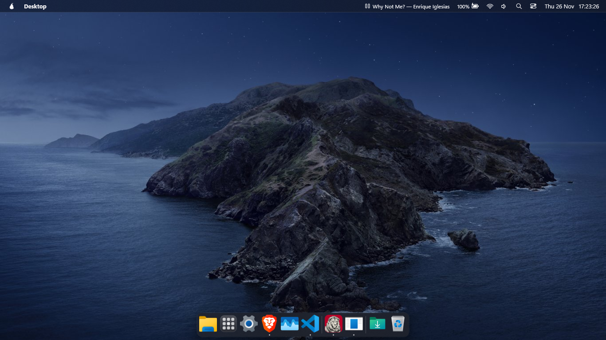
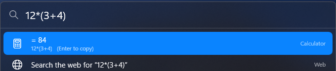
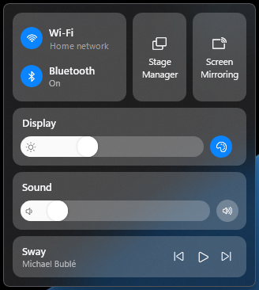
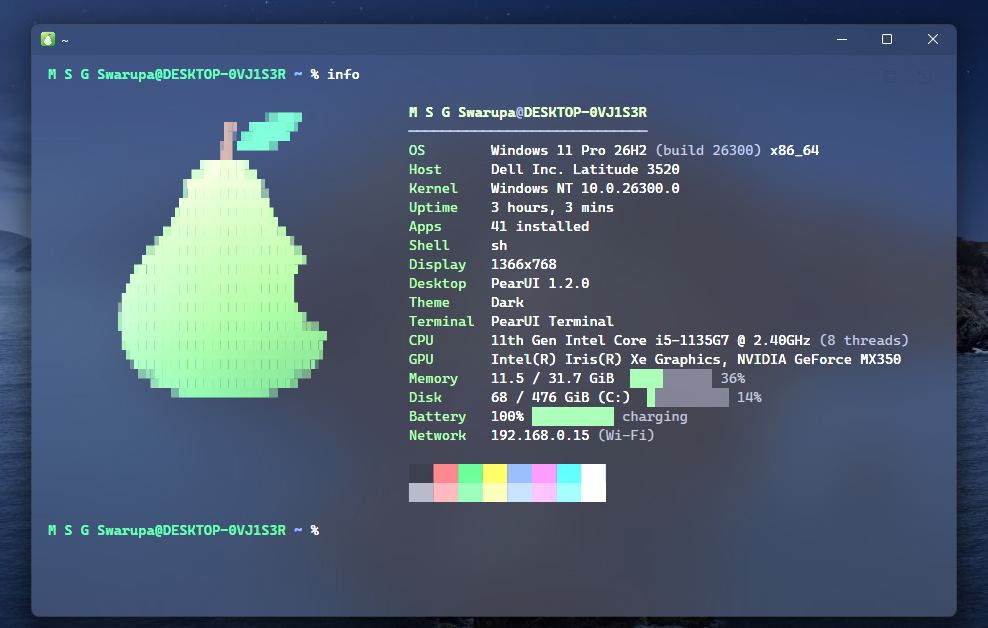
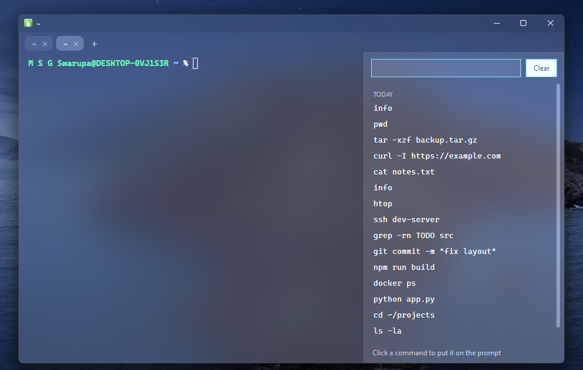
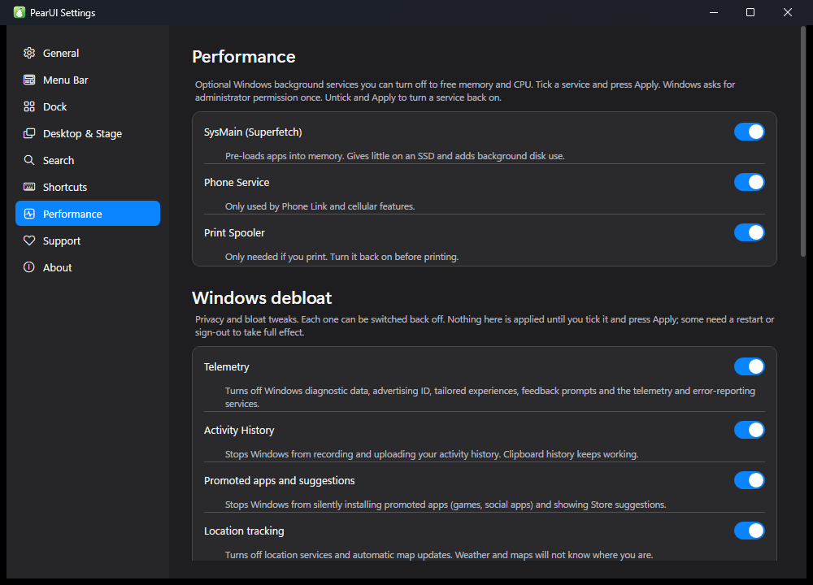
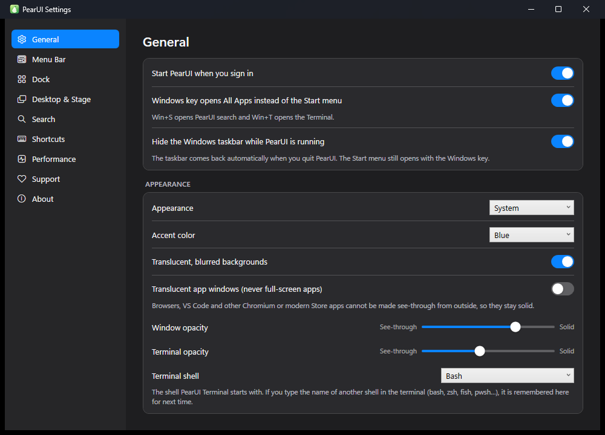
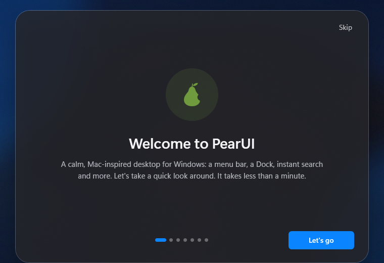
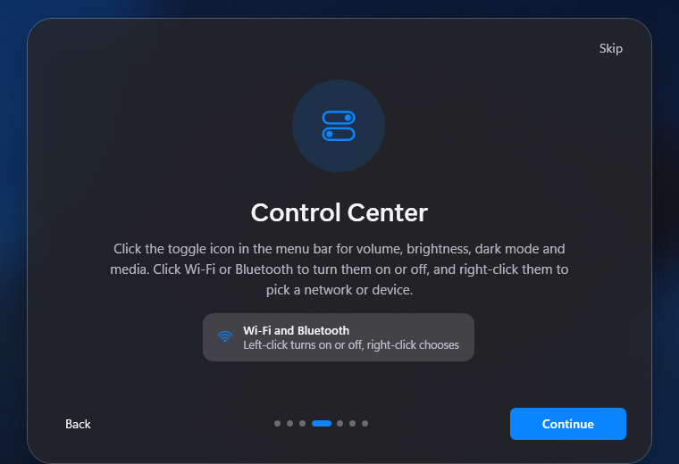
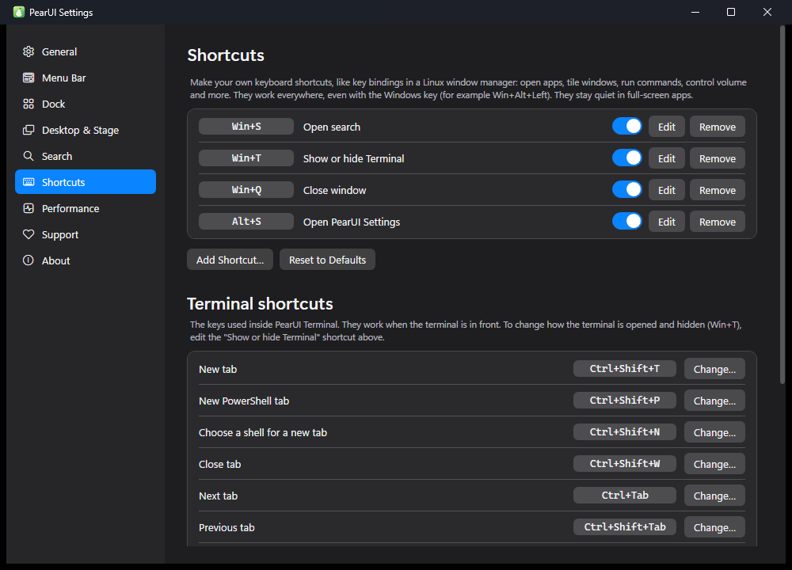

# PearUI

### The Mac inspired desktop your Windows PC was missing.

A menu bar, a Dock, instant search, Launchpad-style All Apps, Control Center and Stage Manager, running on top of the Windows you already have. Free, open source, and fully reversible.

[**⬇ Download for Windows**](https://github.com/guruswarupa/PearUI/releases/latest) &nbsp;·&nbsp; [Features](#what-you-get) &nbsp;·&nbsp; [FAQ](#faq) &nbsp;·&nbsp; [Contribute](CONTRIBUTING.md)

 

---

## Why PearUI?

Windows is powerful, but its desktop can feel cluttered. PearUI gives it a calmer, more focused look: one slim bar on top, a Dock at the bottom, one place to search, and one page for all your apps. It's built for people who like how a Mac feels but need to stay on Windows.

- **It sits on top of Windows.** Your files, apps, drivers, games and shortcuts all keep working.
- **No system files are touched.** Turn any piece off in Settings, or uninstall and everything is put back.
- **Native and light.** A real Windows app, with real blur and rounded corners, not a theme or a web page.
- **Free and open source.** No account, no ads, no telemetry.

> PearUI is an independent project. It is not affiliated with or endorsed by Apple. Mac and macOS are trademarks of Apple Inc.

---

## What you get

### Menu bar and Dock

A slim menu bar runs across the top of every display: the pear menu (Settings, Sleep, Restart, Shut Down, Lock…), the name of the app you're using with its File / Edit / View / Window / Help menus, and on the right your now-playing track, battery, Wi‑Fi, volume, search, Control Center and the clock.

The Dock holds your pinned and running apps. Icons grow as you hover, bounce when an app starts, and a small dot marks the ones that are running. It slides away when you don't need it and returns when you push the pointer to the bottom edge.

- **Window previews:** hover an app to see live thumbnails and titles of all its windows, then click one to jump to it.
- **Drag and drop:** drop files on the Recycle Bin to recycle them, on Downloads to move them there, or on an app to open them with it.
- **Downloads stack:** your latest files with previews. Click to open, or drag them out.
- Right-click an icon for its windows, Keep in Dock, Show in File Explorer, Hide and Quit.

### Search

Press **`Alt` + `Space`** (or **`Win` + `S`**) to find apps, files, settings pages and commands, or just type a sum.

### All Apps

Tap the **Windows key** for every installed app on one full-screen page, over a soft blur of your wallpaper. Type to search, swipe with two fingers to change page, and pinch to close.

**Folders:** drag one app onto another to make a folder, drop more apps on it, and drag them back out. Duplicate shortcuts for the same program are merged, so VLC shows up once.

### Control Center

Volume, brightness, dark mode, media controls, Stage Manager and screen mirroring, all one click away from the menu bar.

- **Wi‑Fi and Bluetooth:** left-click turns them on or off. **Right-click** to pick a network (it asks for the password if needed) or connect to a paired audio device.
- **Dark Mode** switches the whole desktop, Windows included.

### Stage Manager and Hot Corners

Turn on **Stage Manager** to keep one app in focus: push the pointer to the left edge and your other recent apps slide in as previews.

**Hot Corners** run an action when you push the pointer into a corner: Mission Control, show the desktop, Notification Center, All Apps, Search, Stage Manager, lock, or display off.

### PearUI Terminal

Press **`Win` + `T`** to show PearUI's own terminal, and press it again to hide it (your tabs keep running): a frosted-glass window that lets your wallpaper show through, with a Mac-style `user@pc folder %` prompt, tabs (`Ctrl` + `Shift` + `T`) and colors that follow light and dark mode. Choose how see-through it is in Settings.

- **History that lasts:** every command is saved. Press the **Up arrow** in a new session to bring back what you typed days ago, or open the history panel (`Ctrl` + `Shift` + `H`) to search it and click a command to reuse it.
- **A Linux-style shell by default.** It starts with Bash when it's installed (the installer's Linux commands option adds it), with a `user@pc ~ %` prompt. It also finds **zsh, fish, sh, dash, PowerShell, Nushell and WSL** on your PC. Use the shell button in the top-right corner (or `Ctrl` + `Shift` + `N`) to open a tab with any of them.
- **It remembers your shell.** Type `zsh`, `fish`, `bash`, `pwsh`... at the prompt, or pick one from the menu, and the Terminal opens with that shell next time. You can also set it in Settings → General.
- Type **`info`** for a system summary beside the PearUI pear, in the style of fastfetch and neofetch.
- Copy and paste, text selection, scrollback and zoom (`Ctrl` + `+` / `-`).
- **Every key is yours to change** in Settings → Shortcuts: new tab, copy, paste, zoom, history and the rest, plus `Win` + `T` itself.

The installer can also add the everyday Linux commands to Command Prompt and style Windows Terminal to match.

`ls`, `grep`, `cat`, `touch`, `head`, `tail`, `which`, `sed`, `awk`, `nano` and more work right in Command Prompt, with `ll`, `la`, `pwd` and `clear` as aliases. Windows' own commands keep priority, so nothing that relies on them breaks.

### Make Windows lighter

The **Performance** page in Settings lists optional background services and privacy and bloat tweaks: telemetry, activity history, promoted apps, Edge and Brave nags, hibernation and more. Switch on only the ones you want. Each one explains what it does, and every one can be turned back off.

### Translucent windows

Ordinary app windows can be slightly see-through, like frosted glass, with the opacity set in Settings. Full-screen apps always stay solid.

### Made to feel good from the first minute

A short welcome tour shows you around and lets you pick light or dark, an accent color, and whether the Windows key opens All Apps.

  
  
  

### Your own shortcuts

Make keyboard shortcuts for almost anything, the way you would in a Linux window manager. Open **Settings → Shortcuts**, press **Record**, press your keys (the Windows key works too, for example `Win` + `Alt` + `Left`), and pick what it does:

- **Windows:** tile the window to a half or a corner, center it, maximize, minimize, close, or send it to the next display.
- **Apps:** open any app, file, folder or website, run a command, or **switch to an app if it's open and start it if it isn't**.
- **PearUI and system:** search, All Apps, Terminal, Control Center, Mission Control, Stage Manager, dark mode, lock, screenshot, volume, media keys and brightness.

Shortcuts work in every app and stay quiet in full-screen games and videos. `Win` + `S` (search) and `Win` + `T` (Terminal) are just shortcuts you can change.

### And more

- **Real blur and rounded corners**, with a clean fallback if Windows' *Transparency effects* is off.
- **Your shortcuts still work:** `Win` + `E`, `Win` + `D`, `Win` + `Tab` and the rest are untouched. `Win` + `T` opens the Terminal.
- **Starts first at sign-in**, at high priority, so your desktop is ready quickly.
- **The Windows taskbar** can be hidden while PearUI runs. It always comes back when PearUI quits, even after a crash.
- **Stays out of the way** of games, movies and presentations: the Windows key and Hot Corners do nothing in a full-screen app.

---

## Get started

1. Download **`PearUI-Setup`** from the [latest release](https://github.com/guruswarupa/PearUI/releases/latest) and run it. No .NET and no administrator rights needed.
2. Pick what you'd like set up: start at sign-in, the Mac-style Terminal, Linux commands. The defaults are a good place to start.
3. PearUI opens a short tour. Press **`Alt` + `Space`** to search, or tap the **Windows key** to see all your apps.

To remove it, uninstall from *Settings → Apps*. The taskbar, Terminal settings, PATH and start-up entries are restored.

---

## FAQ

**How do I update?**
PearUI checks for a new release a few times a day and offers to update with one click: it downloads the installer from this project's GitHub releases, verifies it, installs it and restarts. Your settings are kept. You can also use **Settings → About → Check for Updates**, or turn automatic checks off there.

**Is it safe?**
PearUI runs as a normal app with no administrator rights and doesn't change Windows system files. The few optional changes (Terminal, Linux commands, the Performance tweaks) are opt-in and reversible. The source is all here to read.

**Will it slow my PC down?**
It's a native app that starts quickly and stays light. The Performance page can also free memory and CPU by switching off background services you don't use.

**Windows shows a warning when I run the installer.**
The installer isn't code-signed yet. Choose *More info → Run anyway*. If *Smart App Control* is on, it blocks unsigned programs completely: turn it off in Windows Security → App & browser control.

**Does it replace File Explorer or the Start menu?**
No. File Explorer stays. You can choose whether the Windows key opens PearUI's All Apps or the normal Start menu.

**Does it work on Windows 10?**
Yes, on Windows 10 and 11. Some visual effects look best on Windows 11.

**Can I make every app translucent?**
Most classic Windows apps, yes. Apps built on Chrome-style engines (Chrome, Edge, VS Code, Discord…) and Store apps can't be made see-through from outside, so they stay solid.

### Known limitations

- Windows apps don't publish their menus, so File / Edit / View send the usual shortcuts instead of showing the app's own menu items.
- Three- and four-finger gestures belong to Windows. Set one to `Alt` + `F1` in *Settings → Bluetooth & devices → Touchpad* to open All Apps.
- Brightness only works on built-in laptop displays.
- Stage Manager works on the main display only.

---

## Join in

PearUI is young and moving quickly, and help is very welcome.

- ⭐ **Star the repo** to help others find it.
- 🐛 **Report a bug** or 💡 **suggest an idea** through [Issues](https://github.com/guruswarupa/PearUI/issues/new/choose).
- 🛠 **Send a pull request.** Start with [CONTRIBUTING.md](CONTRIBUTING.md), which covers building, the project layout and how to submit changes.
- 📣 **Tell a friend** who wishes Windows looked a little calmer.

Please read the [Code of Conduct](CODE_OF_CONDUCT.md) first, and see [SECURITY.md](SECURITY.md) if you've found a vulnerability.

## License

PearUI is released under the [MIT License](LICENSE). © 2026 Guru Swarupa.
